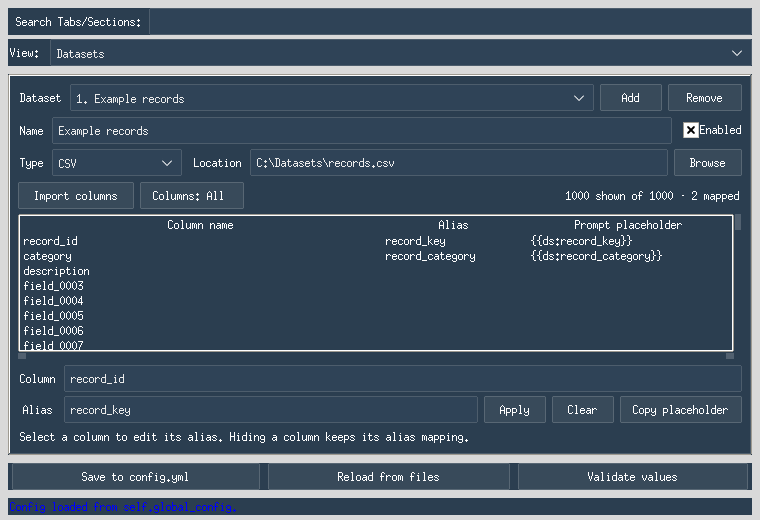

# Dataset sources and task metadata

The **Datasets** tab maps local or remote dataset columns to authored prompt
variables such as `{{ds:nvd_f_name}}`. Each existing generation task receives an
immutable attachment containing one row's mapped values from each enabled source.
The default configuration is `datasets: {sources: []}`; unused sources add no reads.

This integration is based on upstream `59937027eeafa635868328a020a80e5e2e5c01ed`,
including metadata schema 2, random-setting selection/unification, OOC detection,
character-profile-aware quality scoring, and narration-only OOC matching. Dataset
values supply inputs to those existing methods. Original task IDs, queue behavior,
conversation/refinement loops, duplication, output schema, and recovery remain
under the upstream engine's control. Attachments last for the owning queue/run;
they are **not saved for application restart**.

## Datasets tab

1. Open the Configuration Editor and select **Datasets**. Use **Add** for each
   source. The source selector keeps the layout bounded as more sources are added.
2. Choose the source type and location. Hub sources also expose configuration,
   split, and revision; a saved DatasetDict exposes its split selector.
3. Choose **Import columns**. Metadata discovery runs in background workers.
   The panel displays column names, aliases, and placeholders, never record cells.
4. Select a column and enter an alias such as `record_key`. **Apply** saves it;
   **Copy placeholder** copies `{{ds:record_key}}`. An empty alias leaves a column
   unmapped. Aliases must be unique among enabled sources.
5. Save through **Save to config.yml** or a named profile. Source definitions,
   imported names, aliases, and visibility choices survive reloads.
6. Insert the copied placeholders into authored prompts or supported character
   fields, then use the existing generation controls. Task counts still come from
   the questions file or `num_random_chunks`; this feature does not add a new mode
   that enumerates the dataset as its own job queue.

### Many-column layout and visibility

The mapping table has a bounded viewport with vertical and horizontal scrollbars.
It uses native rows and one selected-column editor, rather than a widget per
column. Long column names remain available in the selected-column field.

**Columns: All** is the default for each source. Its dropdown has a bounded,
scrollable list, individual toggles, a search field, and an **All** control.
The markers `[x]` and `[ ]` use plain characters so selection remains visible
even when a system font lacks checkbox symbols. Mouse clicks and Space toggle
rows; Escape or clicking outside dismisses the menu.

Search only filters the dropdown list. It does not change selections, and **All**
applies to the entire schema. Hiding a column preserves its alias and keeps that
mapping active. Each source retains its own visibility settings. All also includes
new names imported later; an explicit partial selection retains its surviving
names after refresh.




These are captures of the actual editor under a Linux virtual display. Fonts,
window decorations, and native control rendering can differ on Windows.

### Drafts, refresh, and saving

Disabled sources and sources with no aliases may be saved as unfinished drafts.
Enabled sources with mappings require an imported schema matching the current
location/config/split/revision settings. Editing those selectors requires another
import before saving active mappings. A refresh that would remove a mapped column
is rejected; clear that alias in the retained table before retrying.

Both main-configuration and profile saves validate these rules. If autosave on
window close fails, the editor stays open with the validation message and all
unsaved changes preserved. Loading or saving settings performs no dataset I/O.
Pending metadata results are discarded after changing selectors, switching or
removing sources, reloading settings, or closing the panel.

## Placeholder syntax

Use `{{ds:alias}}`, for example `{{ds:nvd_f_name}}`. The GUI stores the
alias alone (`nvd_f_name`), independently of the exact source column name.
Aliases are case-sensitive and match `[A-Za-z_][A-Za-z0-9_]*`. They must be unique
across the sources used in a run.

The `ds:` namespace separates dataset variables from the existing `{context}`,
`{subject}`, and other single-brace variables. Unknown dataset aliases and malformed
reserved placeholders are errors. There is no escape syntax for a literal dataset
token in an authored template; such tokens inside inserted data remain literal.
Indexed aliases such as `{{ds:name:2}}` are not supported.

Static authored inputs are copied and expanded for each task: system/answer
instructions, lore, enabled character fields, emotional-state entries, enabled
user-side emotional-state entries (v10.6.0), enabled
name/setting pools, opening styles, and applicable corrective/rotating instructions,
including OOC fixes when that detector is active. Detection phrase lists keep their
upstream literal semantics. The quality scorer receives the character profile
already constructed by the worker from the task's resolved inputs.
The worker always starts from the original templates, including when one worker
processes successive rows. It does not reinterpret the questions-file contents,
source chunks, generated answers, user continuations, or accepted history as
dataset templates.

Question, continuation, greeting/context, and first-line templates are expanded at
their original native formatting boundaries. `render_with_native_placeholders()`
temporarily protects authored dataset slots, performs native substitutions in the
original serial `str.replace` order, and inserts dataset text once. Native values
retain upstream's cascading behavior; direct dataset slots are not rescanned.
For example, a native subject containing `{context}` still expands as it did
upstream, while `{context}` inside a directly inserted dataset value stays literal.

A dataset value used earlier to build a native input (for example, a character
name later used as `{speaker}`) follows the upstream rules for that native input.
Configuration defaults/normalization still run at Start, before row selection;
they are not rerun as a second configuration loader for every row. Runtime empty
continuation and greeting-context checks use the resolved value. No random choices
are made by the renderer, and generated history is never globally rescanned.

The standalone `render_template()` API remains a separate single-pass renderer
for callers wanting both native and dataset insertions to be opaque. The worker
uses the compatibility renderer where upstream native substitution order matters.

## Source interface

`dataset_sources.py` exposes immutable `SourceSpec`, `DatasetSchema`, and
`DatasetRow` records, plus `open_source(spec)`.

| Kind | Input | Discovery / reading |
| --- | --- | --- |
| `csv`, `tsv` | UTF-8 file, with optional BOM | Read exact header names; stream rows |
| `jsonl` | One JSON object per nonblank line | Scan keys across all rows; stream rows during binding |
| `json` | A JSON array of objects | Load the array in memory; prefer JSONL for large inputs |
| `parquet` | Local Parquet file | Schema metadata; batched rows; optional PyArrow |
| `huggingface` | `owner/dataset` plus config/split/revision | Pin the repository to a commit; schema metadata and streamed rows; optional Datasets backend |
| `hf_disk` | Directory created by `Dataset.save_to_disk()` | Select one saved DatasetDict split or a single Dataset; optional Datasets backend |

Creating a source opens nothing. `source.schema()` returns column names and
metadata, never row values. JSON key discovery must read the file, but does not
retain values in the returned schema. The panel runs discovery off the GUI thread.
The file readers handle exact top-level column names; dotted names are literal
columns, not nested field paths. Nested JSON cells serialize as JSON when bound.

Paths, quotes, backslashes, and exact column names are preserved. This code does
not use the application's destructive input sanitizer. Duplicate headers/keys,
wrong row shapes, missing mapped fields, and unsupported cell types are explicit
errors. Sparse JSON records can expose a column in their schema but still fail
if a selected record lacks that mapped column.
Opening a CSV/TSV source raises Python's process-wide CSV field-size limit to
accommodate long text cells; importing this module alone does not change it.

Local fingerprints use file identity, size, and modification time (saved
directories use a file list with sizes/times). They detect ordinary edits, not
all possible content changes. Already-bound values remain valid after a source
changes; attempting to read further rows from a changed local source fails.
Remote schemas carry the resolved commit/config/split as well as a fingerprint.
Remote files outside the repository may have their own mutability limitations.

Hub sources require supported data files and declared feature metadata at the
chosen revision. There is no fallback to a different revision or a preview row
if metadata is missing. Multiple configurations/splits require an explicit choice.
These are text/tabular readers; no automatic image/audio-to-text conversion is
provided. Streaming can still download a full file for some underlying formats.

## Per-job ownership

```python
from dataset_sources import SourceSpec, open_source
from dataset_bindings import DatasetBindingManager, SourceBinding, TaskBinding
from dataset_templates import render_template

people = open_source(SourceSpec("people", "csv", "people.csv"))
content = open_source(SourceSpec("content", "jsonl", "content.jsonl"))

with DatasetBindingManager("unique-run-id", [
    SourceBinding(people, {"first_name": "first", "last_name": "last"}),
    SourceBinding(content, {"body": "body"}),
]) as bindings:
    job = bindings.bind("unique-job-id")
    prompt = render_template(
        "{{ds:first}} {{ds:last}}: {{ds:body}}\n{context}",
        job.values,
        {"context": "The stage's existing context."},
    )
    assert bindings.bind("unique-job-id") is job
    restored = TaskBinding.from_dict(job.to_dict())
    assert restored.values == job.values
```

Supply any number of sources, with globally unique source IDs and aliases.
Only mapped/enabled sources belong in the manager. Each source contributes its
next row to each new job; every mapped column from that source comes from that
one row. Sources have separate cursors. This first policy pairs their sequential
positions; it does not perform joins, Cartesian products, random sampling, or
silent cycling. Exhaustion fails clearly.

Allocation is coordinated across workers, while rendering and model requests
take place after the allocation lock is released. Candidate rows are staged
until all sources succeed. Repeated `bind(job_id)` calls return the original
immutable values; they do not allocate new rows. Source readers and manager
instances belong to one run and must not be shared between runs. The application
keeps upstream's original task IDs. Duplicate entries bearing the same ID therefore
receive the same binding; this integration does not introduce new identities or
change upstream's job deduplication rules.

Strings are preserved verbatim. Top-level null becomes an empty string. Other
JSON-compatible cells become compact JSON with sorted object keys and Unicode
preserved. Nulls inside JSON stay `null`; booleans become `true`/`false`.
Non-finite numbers and Python-only objects fail rather than using their repr.

`TaskBinding.to_dict()` and `from_dict()` can serialize and restore one binding for
standalone callers. The application does not invoke them from its state saver.
`manager.close()` releases readers while retaining existing bindings; new row
allocations are then prohibited.

## Worker attachment boundary

`dataset_tasks.configure_queue_datasets()` attaches a lazy service to the existing
queue. It validates and copies source configuration without opening readers. A
worker's first `bind_task_datasets()` call obtains an immutable binding and exposes
the same object as `app_state.task_metadata[task_id]['dataset_binding']` when that
metadata entry still describes the exact task tuple. The worker retains its local
reference for the attempt. A newer run cannot redirect that reference to its row.

The allocation lock is released before any model request. Requeues on the same
queue retrieve the already assigned binding. Config edits do not change a live
queue's selection or mappings. Readers close when the queue is released, so an old
worker retaining its queue is not interrupted by a replacement queue's cleanup.

The source allocation order is worker arrival order, not a promise that task
number N receives physical row N. Each source advances once per new task ID.
Source exhaustion or a read error latches further allocation failure, while
already-bound tasks retain their values. Such errors use the original worker's
exception handling; this feature does not add new failure/requeue policies.

### Existing generation behavior

- Dataset settings are resolved before upstream's own-setting/empty-setting checks
  and ensemble unification. The effective chosen setting still supplies scene
  prompts and `meta_setting` through upstream's code.
- The answer/refinement functions, dedicated fixers, detection, output writer,
  quality layer, cache/rate limiter, and state saver keep their original methods.
- The original shared-history duplication flow and per-turn output writes remain.
- The internal attachment is not a model message or extra API payload field.
  Output schema 2 is unchanged; it does not receive arbitrary dataset alias keys.

### Recovery boundary

Attachments are in memory for one queue/run. Same-queue retries retain values;
Start creates a new queue and new source cursors, even when upstream restores its
completed-task IDs. The original state file does not save dataset values, source
cursors, pending task payloads, or partially generated conversations. Neither an
application restart nor a new queue guarantees the prior dataset assignments.
This is deliberately the original recovery behavior, not the earlier experimental
durable-runtime implementation. No checkpoint files or job IDs from that discarded
integration are produced by this branch.

## Optional dependencies and compatibility boundary

All foundation modules and CSV/TSV/JSON/JSONL readers use Python's standard
library and remain compatible with the application's Python 3.9 language target.
Optional packages are imported only when their reader is used. The normal
`requirements.txt` installation does not include Hugging Face or PyArrow.

The optional installation includes both the application and dataset dependencies:

```sh
python -m pip install -r requirements-datasets.txt
```

This pins `datasets==4.4.2`. Its dependencies
include PyArrow, so it covers local Parquet and saved-HF folders too. Datasets
4.x does not execute dataset scripts. Later releases can raise the Python minimum,
which is why the tested optional backend is pinned explicitly here.

The application's Requests requirement is `requests>=2.32.4,<3`, which also
satisfies Datasets' `>=2.32.2` requirement. The combined install and existing
application regressions were tested on Python 3.12, not every interpreter.

Authentication uses Hugging Face's normal environment or saved-login mechanism;
no access token is included in source settings or binding snapshots. No login,
Hub request, or model API call occurs just by importing these modules.

Primary API references:

- [Datasets 4.0 loading and streaming API](https://huggingface.co/docs/datasets/v4.0.0/package_reference/loading_methods)
- [Datasets 4.4.2 declared dependencies](https://github.com/huggingface/datasets/blob/4.4.2/setup.py)
- [Hugging Face repository metadata API](https://huggingface.co/docs/huggingface_hub/package_reference/hf_api#huggingface_hub.HfApi.dataset_info)
- [Requests release and Python support history](https://requests.readthedocs.io/en/latest/community/updates/)

## Verification

Run the dependency-free foundation checks with:

```sh
for t in sources bindings templates settings pipeline tasks; do python -B tests/test_dataset_$t.py; done
```

After installing the optional requirements, also run the real local backend tests:

```sh
python -B tests/test_dataset_backends.py
```

Those tests use actual Parquet files and `Dataset.save_to_disk()` fixtures. They
skip explicitly when optional packages are absent; a skipped suite does not
count as backend validation. All automated suites avoid network and model calls.

A live Hub check is deliberately opt-in and displays names/provenance, not cells:

```sh
python -B tools/check_dataset_hub.py --repository cornell-movie-review-data/rotten_tomatoes --config default --split train --column text --column label --rows 2
```

### Step 2 evidence (2026-10-28)

The isolated Linux/Python 3.12.14 environment resolved Requests 2.34.2, Datasets
4.4.2, PyArrow 26.0.0, and huggingface-hub 1.33.0. `pip check` reported no broken
requirements. The combined requirements installed in a clean temporary environment.

- 48 foundation tests cover exact columns, correlated rows, immutable bindings,
  source exhaustion/edits, snapshot serialization, concurrency, and literal text.
- 13 tests used real Parquet and saved-HF fixtures, including a Parquet batch
  boundary, saved NumPy formatting, DatasetDict splits, and reader closure.
- 7 orchestration simulation tests exercised six request stages, transient
  failures, whole-job handoff, caching, and source-free snapshot replay.
- Twenty concurrent jobs produced 120 simulated requests while consuming exactly
  twenty rows per source. Twenty concurrent callers for one job consumed one row
  per source; binding reuse is distinct from deduplicating job scheduling.
- Request retries reused identical serialized bodies. A failed job retained its
  binding when another live worker processed a different job before retrying it.
- Saved binding plus original job payload reproduced the original requests after
  source files were removed. This is replay of a job, not continuation recovery.
- The live Hub check read two rows successfully from the public test repository
  at revision `aa13bc287fa6fcab6daf52f0dfb9994269ffea28`, retaining its `default`
  configuration, `train` split, and `text`/`label` columns through binding/replay.
- The existing API-profile, persona/arc, and opening-mode regression scripts pass
  with the combined dependency environment. The opening-mode script contained a
  stale legacy-output fixture in the upstream baseline: it expected no metadata
  while the writer already defaulted to including it. Its one legacy-format call
  now explicitly sets `include_metadata=False`; production output is unchanged.

The Step 2 orchestration harness is a simulation using the actual source,
binding, and rendering modules. It does not itself test `generation.worker`,
application recovery, or the production cache. The production compatibility suite
below adds real-worker traces against the newer upstream version. No paid model
calls, GUI interaction, Windows execution, repository push, or PR was part of
the historical Step 2 validation checkpoint.

### Step 3 evidence (2026-10-28)

All 89 non-GUI dataset tests passed, including 21 settings tests and the optional
local backends, with no skips. The existing API-profile, persona/arc, and
opening-mode scripts also passed: 28, 45, and 179 checks respectively.

Run the actual Tk GUI suites separately with the normal application dependencies
and a desktop or virtual display:

```sh
python -B tests/test_dataset_column_menu.py
python -B tests/test_datasets_panel.py
```

All seven dropdown tests and all seven panel/editor tests passed with no skips.
Together with the non-GUI suites, that is 103 dataset tests. The GUI checks used
Linux, Python 3.12.14, Tk 9.0.4, and ttkbootstrap 2.2.6. They exercised:

- 1,000 columns, including very long names, with constant widget counts and
  bounded table/dropdown geometry. The full editor was checked at 760 by 520 and
  1366 by 700 client sizes; 32 sources were added and retained in the panel.
- All/partial/empty visibility, search, mouse and keyboard toggles, focus/grab
  restoration, menu dismissal, and source-specific visibility persistence.
- Background CSV metadata discovery with a responsive Tk event loop, reader
  closure, no row iteration requested by the GUI, and no record cells in settings.
- Late/out-of-order results, source switching/removal, settings reload, and panel
  destruction while metadata requests were outstanding.
- Exact placeholder copying, hidden alias retention, schema refresh rejection,
  actual profile save/load, main configuration save, and preservation of unsaved
  changes when validation blocks window-close autosave. Disabled drafts save intact.

`READYART_GUI_SCREENSHOTS` optionally gives the panel suite a screenshot directory.
Visual review caught missing Unicode checkbox glyphs; the dropdown now uses the
portable markers shown above. No model API calls were used for these checks.
Windows hands-on verification was outstanding at this checkpoint; see the later
Windows verification results below.

### Compatibility of dataset-bound and typed-in inputs

Run this suite in its own process:

```sh
python -B tests/test_dataset_compatibility.py
```

It runs the current engine twice for each scenario, each run in a separate process. The
baseline run receives manually populated authored inputs; the candidate run receives
equivalent aliases and actual CSV/JSONL bindings. Twelve differential traces
compare API payloads/order, cache keys, accepted history, output/schema-2 metadata,
selection counters, and completion/requeue decisions:

- Multi-turn generation with refusal correction, repeated slop/anti-slop rewrites,
  and rotating instructions.
- Two-model duplication using the shared conversation prefix and per-turn writes.
- Opening mode, perspective switching, random names, persona and emotional arcs.
- Two different rows on successive jobs handled by one worker.
- Empty dataset settings using the random-settings pool, and ensemble setting unification.
- Whole-job requeue with the same attachment and the original retry decisions.
- Disabled datasets with the original native-placeholder cascade.
- Empty resolved continuation and greeting-context templates.
- OOC corrections for two successive dataset rows on one worker, including
  detection counters, literal detection phrases, and quoted-dialogue immunity.
- The actual quality scorer receiving the resolved character profile and recording
  the scripted judge's score in output metadata.

The independent task-attachment tests cover 20 concurrent
jobs, same-ID callers, source failures, queue ownership, and resource cleanup.

These are scripted HTTP tests using the opening-mode test harness. They do not make
paid model calls, hit real Valkey, exercise real provider failures, or establish
equivalence for every configuration. The existing upstream API-profile,
persona/arc, opening-mode, and random-setting tests must also pass. Windows
hands-on verification remains a separate check.

The newer upstream worker launcher passed its three OOC options into positional
slots already supplied by opening-mode keyword arguments. This raised
`TypeError: multiple values for argument 'opening_mode_local'` before the worker
could run. The integration moves those three arguments to their existing named
parameters; it does not change the worker signature or OOC retry method.
`tests/test_worker_launch.py` checks the actual launch expressions against the actual
worker signature without importing or running the GUI. This startup correction
is separate from the worker-driven differential tests.

### Windows verification of the original integration

The original integration at `d05655bb` (based on `f04ed7bc`) received a favorable
Windows GUI review. On that exact branch, the user reported all 17 task-attachment
tests passing in 0.039 seconds and all ten behavioral compatibility scenarios
passing in 8.216 seconds. The structural byte-comparison check was excluded from
that Windows command because the original test did not account for checkout
line endings. It had already passed on Linux.

Those Windows results apply to that checkpoint. The subsequent upstream merge
adds the OOC and quality scenarios above and makes the source comparison handle
CRLF. Live model endpoint verification remains pending; no model endpoint is
needed to run these scripted tests.

### Validation after merging upstream v10.3.5 and v10.3.6

The merged implementation passed 121 source/binding/settings/renderer/task/backend
tests, all 13 compatibility tests (twelve traces plus the source-preservation gate),
all 14 actual Tk dataset GUI tests, and the worker-launch regression test. All four
existing upstream regression scripts also passed. The opening-mode script's
expected keyword set now includes the three correctly named OOC arguments.

The GUI round-trip checks saved and reloaded enabled OOC detection phrases/fixes
and dataset mappings together, through both the main configuration and the actual
profile-load handler. No dataset source reads occurred during those saves/loads.
The new launch regression failed on untouched `9f49ceb7` and `59937027` with the duplicate
opening-mode argument and passed after the narrow caller correction.

Upstream `59937027` subsequently changed only OOC narration matching, explanatory
comments, and the displayed version. Its changes were merged without altering
the dataset modules or editor integration. The full compatibility suite was rerun
against that exact baseline, including quoted OOC phrases in corrected replies.

These post-merge results are from Linux. The Windows results above remain tied to
`d05655bb`; a later Windows run must be recorded separately. No live provider,
GPU inference, or real Valkey service was used.

### Historical validation before the upstream merge

Validation on this integration passed 121 source/binding/settings/renderer/task
tests, all 11 compatibility tests (ten traces plus the structural gate), all four
upstream regression scripts, and all 14 actual Tk dataset GUI tests with no skips.
The GUI was also checked with the new random-settings controls and dataset mappings
together, including main configuration and profile round trips.

One existing upstream GUI edge case was reproduced and left unchanged: loading
a different settings pool while the random-settings text widget is disabled can
leave the old pool visible after the widget becomes enabled. The same behavior
occurs in unmodified `f04ed7bc`; saving immediately can retain the stale pool.
Review the pool text after that transition. This integration does not alter the
upstream random-settings widget's enable/load ordering.

The same class of issue was reproduced for the new OOC text fields in both
untouched `9f49ceb7` and the merged editor: loading an enabled profile after a
disabled one updates the enabled flag and saved configuration, but the phrase
and fix widgets can retain their previous text. Inspect those fields before the
next save. This inherited GUI issue is documented and left unchanged.
